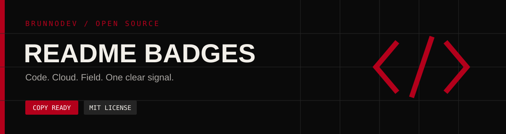

<div align="center">



# README Badges

**A small visual language for the things you build.**

Copy-ready badges for code, cloud, field systems and the people behind them.
Curated by [Brunno Dev](https://brunnodev.store).

[Browse the catalog](CATALOG.md) · [Build your own](#make-it-yours) · [Sponsors](#sponsors) · [Contribute](CONTRIBUTING.md)

[](LICENSE)
[](https://github.com/brunnojob/readme-badges/stargazers)
[](https://buymeacoffee.com/brunnodev)

</div>

## Pick your signal


| Collection | Use it for |
| --- | --- |
| [Languages](CATALOG.md#languages) | Your programming stack |
| [Web and APIs](CATALOG.md#web-and-apis) | Frameworks and interfaces |
| [Data](CATALOG.md#data) | Databases and messaging |
| [Cloud and delivery](CATALOG.md#cloud-and-delivery) | Infrastructure and deployments |
| [Tools and testing](CATALOG.md#tools-and-testing) | Development workflows |
| [Mobile](CATALOG.md#mobile) | Native and cross-platform apps |
| [Embedded and hardware](CATALOG.md#embedded-and-hardware) | Devices and field projects |
| [Industrial automation](CATALOG.md#industrial-automation) | PLC, SCADA, telemetry and control |
| [Project signals](CATALOG.md#project-signals) | Licenses and project status |
| [Brunno Dev](CATALOG.md#brunno-dev) | Profile, portfolio and support |

## Copy in seconds

Open the [catalog](CATALOG.md), copy a Markdown snippet and paste it into a README:

```md

```

To make the badge clickable, wrap it in a link:

```md
[](https://brunnodev.store)
```

Badges are images. They do not grant GitHub achievements, verify skills or change repository permissions.

## Make it yours

Choose `flat`, `flat-square` or `for-the-badge` using the `style` parameter. Colors use a hex value without `#`. Logo names follow [Simple Icons](https://simpleicons.org/).

For a custom label, follow the [Shields static badge syntax](https://shields.io/badges/static-badge). Spaces can be encoded as `%20`; literal hyphens and underscores are doubled before URL encoding.

```text
https://img.shields.io/badge/LABEL-HEX?style=for-the-badge&logo=LOGO&logoColor=white
```

The catalog is generated from [badges.json](badges.json) with Python's standard library:

```sh
python scripts/build.py
python scripts/build.py --check
python -m unittest discover -s tests
```

## Sponsors

Thank you to the people supporting my open-source work.

<!-- sponsors:start -->
<table>
<tr><td align="center" width="160"><a href="https://github.com/ineedfoundmyway"><br /><strong>@ineedfoundmyway</strong></a></td><td><strong>Thank you, @ineedfoundmyway.</strong><br />Your support helps me maintain practical open-source projects and build new tools.</td></tr>
</table>
<!-- sponsors:end -->

Sponsor benefits include code reviews, troubleshooting, project guidance and opportunities to collaborate. Personal assistance requires sponsor verification and agreed availability. GitHub Sponsors access instructions are provided privately after payment on the active tier; public README content remains available to everyone.

[Support on Buy Me a Coffee](https://buymeacoffee.com/brunnodev) · [GitHub Sponsors](https://github.com/sponsors/brunnojob)

Public GitHub sponsors refresh hourly. One-time supporters remain in the thank-you list. Buy Me a Coffee contributions require separate verification and are not imported automatically.

## Credits and license

Created and maintained by [Brunno Dev / @brunnojob](https://github.com/brunnojob) — [brunnodev.store](https://brunnodev.store).

Inspired by the badge-catalog format of [alexandresanlim/Badges4-README.md-Profile](https://github.com/alexandresanlim/Badges4-README.md-Profile). This repository has its own curated data, documentation and generator; it does not copy the upstream catalog.

Badge rendering is provided by [Shields.io](https://shields.io/), with brand icons from [Simple Icons](https://simpleicons.org/). Logos and brand names belong to their owners; availability and trademark terms may vary.

Original source, catalog data and documentation are [MIT licensed](LICENSE). Third-party logos and services retain their own terms.
